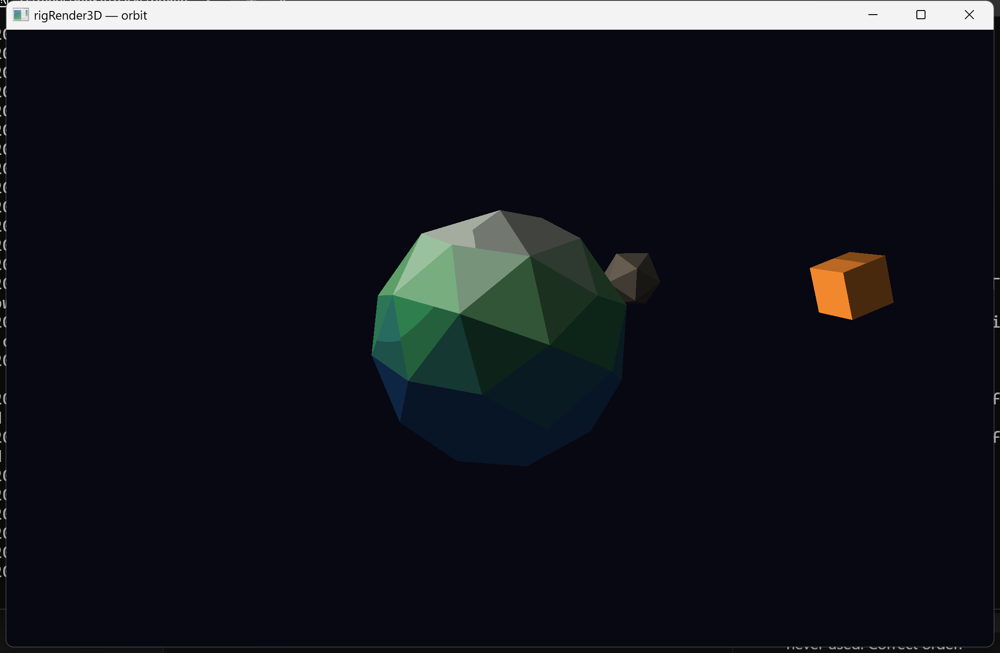

# rigRender3D





Code pack - GLES mesh present over [rigComponent](https://github.com/rigkid/rigComponent) `CCamera` + `CMesh` (`faceColors` / `facePalette` + `CPalette` ramps, optional `CIndexedAtlas` + `texcoords`) + `CDrawStyle`, with optional `CLight` (banded shade by default; ordered Bayer dither optional). Optional low-res present via `CCamera::presentWidth` / `presentHeight` (nearest upscale). Corner FPS is host `GraphicsSettings::showFps`, not this pack. Pi floor: same shader path as host GLES2 / ANGLE.

`CMesh::texcoords` alone are not enough: without a scene `CIndexedAtlas`, UVs are ignored and albedo stays face/style colors.

## Build Example

[examples/orbit](examples/orbit/) - low-poly planet system: faceted `CMesh` planet + two orbiting moons, a circling point light, and a `COrbitDrive` camera

```bash
cmake -S examples/orbit -B examples/orbit/build
cmake --build examples/orbit/build --target orbit
```

Bootstrap: register **rigComponent**, then **rigSystems**, then **rigRender3D**. When any `CCamera` is active, `rigSystems` skips 2D mesh present so this pack owns meshes.

[API/docs](https://rigkid.github.io/rigRender3D/)
