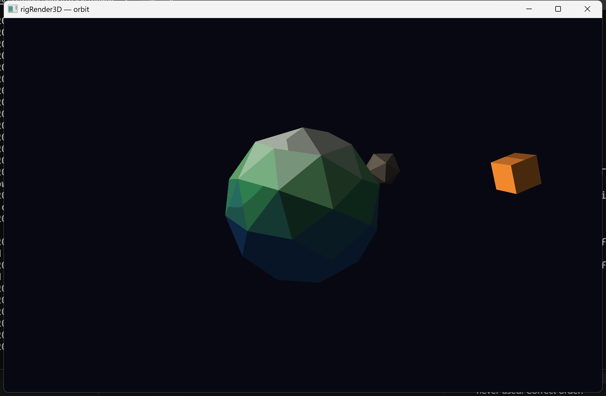

# orbit



Hero for **rigRender3D** — a tiny low-poly planet system on the GLES/desktop present path. A
faceted icosphere planet (per-face `CMesh::faceColors`) spins in place while a rocky moon and a
box moon orbit it at different radii and speeds. A `CLight::Type::Point` circles the scene,
sweeping banded shade across the facets, and the camera itself orbits via `COrbitDrive` +
`rig::lookAt` — no input handling needed to see the pack from every angle.

```bash
cmake -S . -B build
cmake --build build --target orbit
./build/bin/orbit/orbit
```
